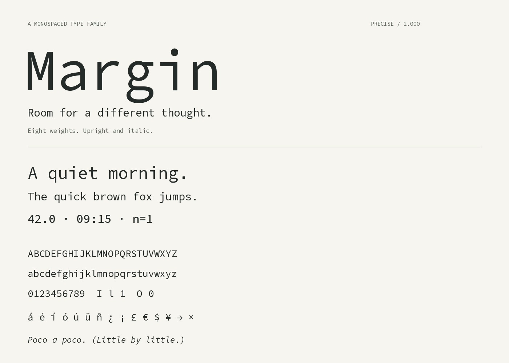
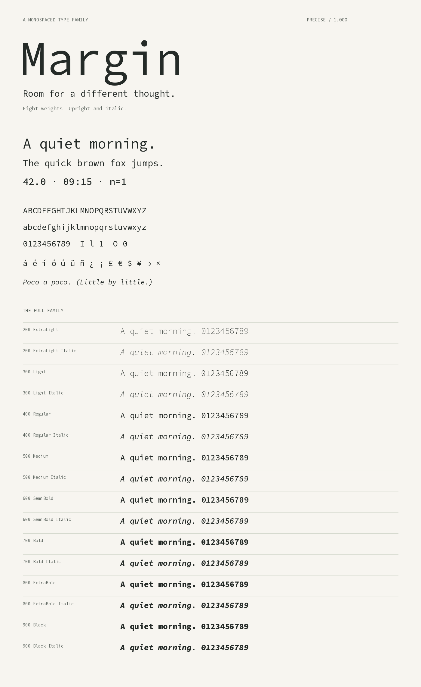

# Margin

A precise monospaced font for personal apps, journals, and tools.

Margin pairs fixed character widths with narrow proportions, restrained details, and a separate italic design. It supports long-form text, interface labels, and aligned data.



## Download

[Download the complete repository](https://github.com/fringe-create/margin-font/archive/refs/heads/main.zip), or choose the files you need:

| Platform | Files |
|---|---|
| Web apps | [Variable WOFF2 fonts and CSS](web/) |
| Native apps and desktop tools | [16 static TTF styles](fonts/static/) |
| Platforms with variable font support | [Variable TTF fonts](fonts/variable/) |

Download the repository, extract it, and open [preview.html](preview.html) in a browser for an editable specimen. The preview runs offline and includes weight, size, and italic controls. GitHub displays the HTML source rather than running the preview.

## Design

Margin follows the Precise design direction:

- Fixed 564-unit character advance on a 1,000-unit em.
- Narrow proportions, with outlines and spacing compressed horizontally by 6% from the foundation font.
- Chamfered punctuation dots.
- A small outward extension on the lower leg of R.
- Distinct forms for I, l, and 1, plus a dotted zero.
- Separately drawn italic forms, inherited from the foundation's italic masters.

Margin is a customized derivative of [Adobe Source Code Pro](https://github.com/adobe-fonts/source-code-pro), designed by Paul D. Hunt. It is not a typeface drawn entirely from scratch. Fragment Mono informed the visual direction, but its font files are not used in this build.

## Styles

| Weight | Style | Upright | Italic |
|---|---|---|---|
| 200 | ExtraLight | Yes | Yes |
| 300 | Light | Yes | Yes |
| 400 | Regular | Yes | Yes |
| 500 | Medium | Yes | Yes |
| 600 | SemiBold | Yes | Yes |
| 700 | Bold | Yes | Yes |
| 800 | ExtraBold | Yes | Yes |
| 900 | Black | Yes | Yes |

The variable fonts support intermediate weights, such as 450 or 625. The supported range is 200 to 900. There is no Thin 100 style.



## Use in a web app

Copy the contents of `web/` to your public font directory. Keep both WOFF2 files beside `margin.css`.

```html
<link rel="stylesheet" href="/fonts/margin/margin.css">
```

```css
body {
  font-family: 'Margin', ui-monospace, monospace;
  font-weight: 400;
  font-size: 16px;
  line-height: 1.6;
  font-synthesis: none;
}

h1, h2 {
  font-weight: 500;
  letter-spacing: -0.025em;
}

button, input, textarea, select {
  font: inherit;
}

em { font-style: italic; }
strong { font-weight: 700; }
```

The font name is `Margin`. Use normal CSS `font-weight` and `font-style` properties. Avoid loading both static and variable versions as duplicate faces.

See [USAGE.md](USAGE.md) for native app setup and file selection.

## Character coverage

Margin retains the foundation font's character set, including English, Spanish, Latin extensions, Greek, and Cyrillic. It includes accents, currency symbols, arrows, and common mathematical symbols. It does not cover every writing system. Use a platform fallback for unsupported scripts and emoji.

Combining marks have zero advance. Ordinary text characters use the fixed character width.

## Build from source

Python 3.10 or later is recommended.

```sh
python -m venv .venv
source .venv/bin/activate
python -m pip install -r requirements.txt
python source/build.py
```

On Windows, activate the environment with `.venv\Scripts\activate`.

The build produces all 16 static TTF files, two variable TTF files, and two variable WOFF2 files. Original font inputs are included in [source/upstream/](source/upstream/), with input hashes in [source/input-hashes.json](source/input-hashes.json).

## Validation

The initial build passed:

- Full font-table decoding for all 20 output files.
- Fixed-width checks for ASCII letters, numbers, spaces, and punctuation.
- English and Spanish character coverage checks.
- HarfBuzz text shaping and FreeType rendering for TTF files.
- Variable weight range checks, eight named instances, and interpolation at weight 525.
- Visual review of all 16 static styles.

Results and output hashes are recorded in [validation.json](validation.json). Browser rendering and integration in a shipping app remain to be tested. The build script does not regenerate the preview images or validation report.

## License and credits

Margin is distributed under the [SIL Open Font License 1.1](LICENSE.txt). Include [OFL.txt](OFL.txt) and [NOTICE.txt](NOTICE.txt) when redistributing the font files. The font can be embedded in commercial apps under the OFL terms.

Original design: Paul D. Hunt / Adobe.

Margin modifications: generated by OpenAI for Margin contributors.

Version: 1.000. See [CHANGELOG.md](CHANGELOG.md).
